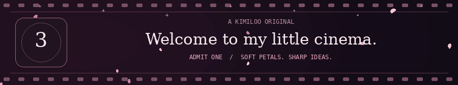
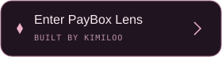
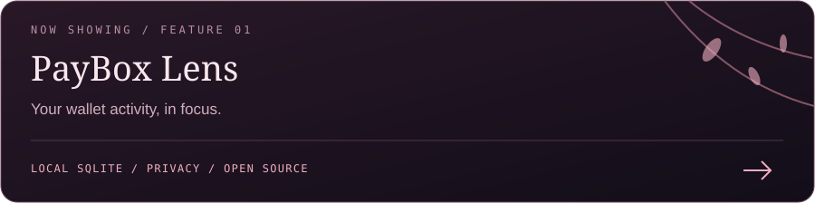
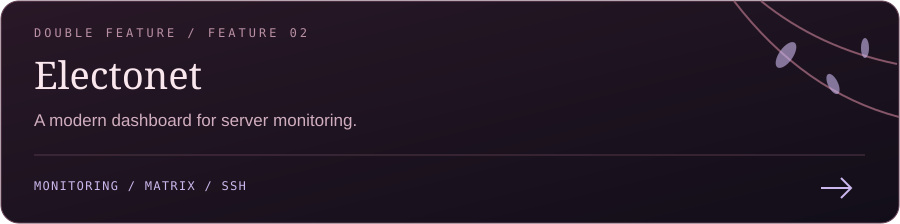
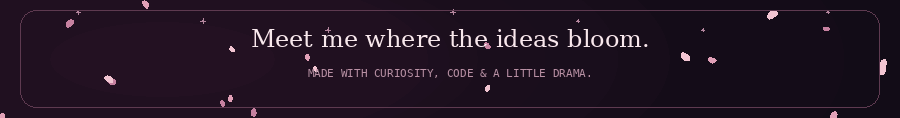

<picture>
  <source media="(prefers-reduced-motion: reduce)" srcset="assets/cinema-intro-still.png">
  
</picture>

 

<picture>
  <source media="(prefers-reduced-motion: reduce)" srcset="assets/casting-still.png">
  
</picture>

  

### 🌸 ACT I · MEET THE CREATOR

**Hey, I'm Kimiloo.**

I make AI films, explore Web3, and turn ideas into things you can actually use. 
Sometimes it's a cinematic story. Sometimes it's a dashboard. 
Usually, there's a little pink in the plot.

**Soft petals. Sharp ideas.**

 

### 🎞️ ACT II · NOW SHOWING

An independent financial dashboard for PayBox. 
Local SQLite, wallet activity, reports and privacy controls.

[Explore the source](https://github.com/kimilooo/paybox-lens) ·
[See the screenshots](https://github.com/kimilooo/paybox-lens#screenshots) ·
[Report a bug](https://github.com/kimilooo/paybox-lens/issues/new?template=bug_report.yml)

Server monitoring, Matrix management and an SSH-based architecture.

[Explore Electonet](https://github.com/kimilooo/electonet) ·
[Browse the full collection](https://github.com/kimilooo?tab=repositories)

 

### 🎀 ACT III · BEHIND THE SCENES

**The stories:** AI video · digital art · Web3 · creative experiments 
**The builds:** useful dashboards · small tools · open-source projects 
**The workflow:** Codex · Claude · VS Code · Higgsfield · ImagineArt · Remotion

 

<b>🎟️ Open the director's notes</b>

 

I share what I build, what I learn, and what actually works. 
Bug reports, thoughtful feedback and pull requests are welcome. 
Have a creative project in mind? Find me on [X](https://x.com/Kimilooweb3).

 

This little cinema uses original artwork and self-hosted motion graphics. 
The illustrated character is fictional; this is a creative identity, not a photograph. 
[Artwork and animation notes](DESIGN.md)

  

<picture>
  <source media="(prefers-reduced-motion: reduce)" srcset="assets/end-credits-still.png">
  
</picture>

WRITTEN, DIRECTED & BUILT BY <b>KIMILOO</b> · THANKS FOR WATCHING ♡

